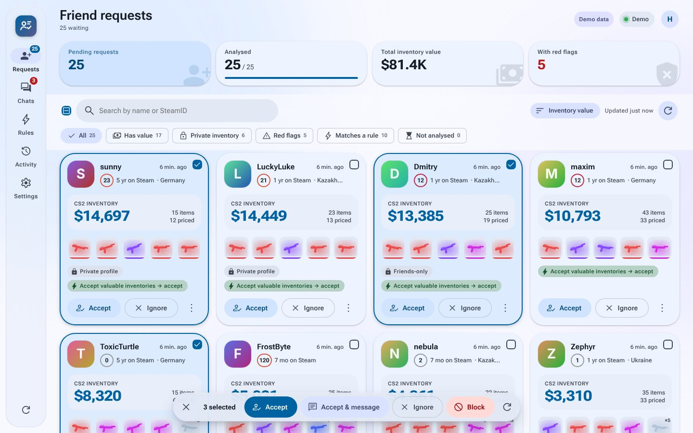
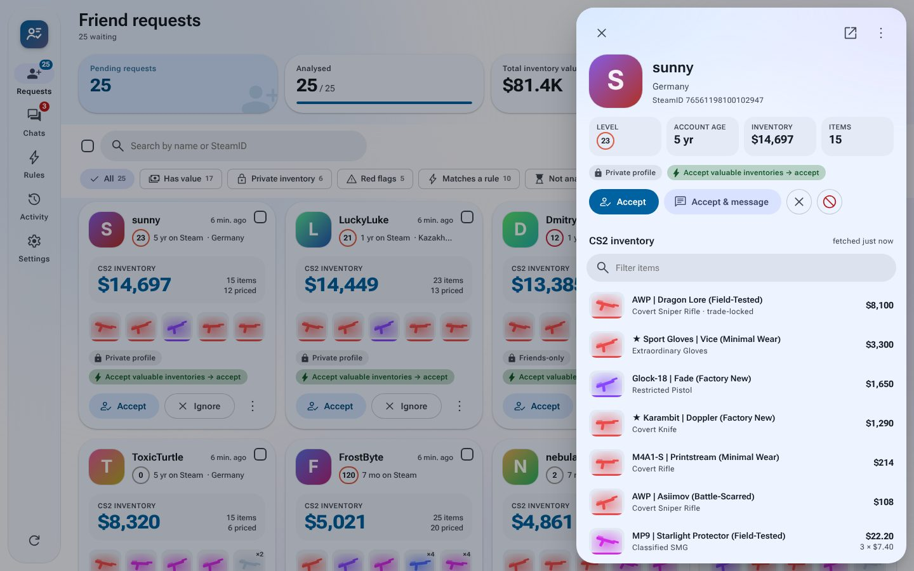
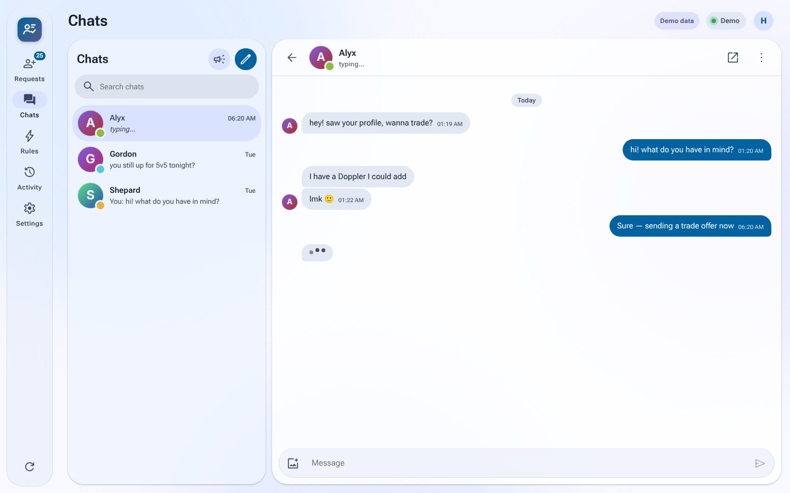
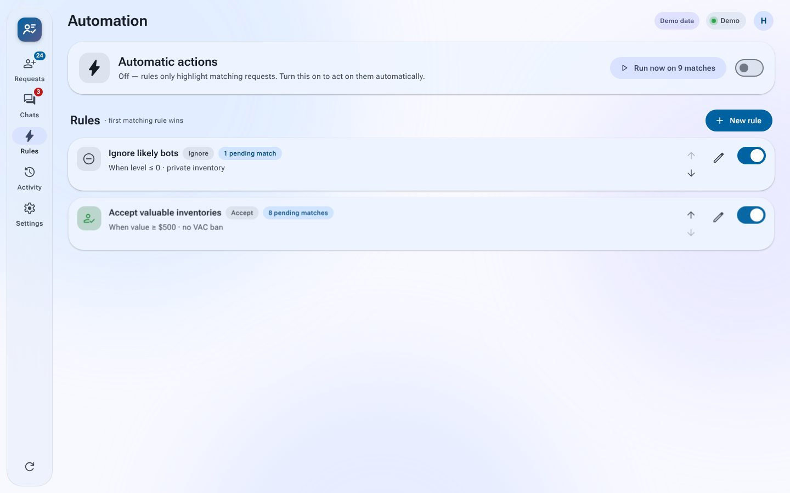
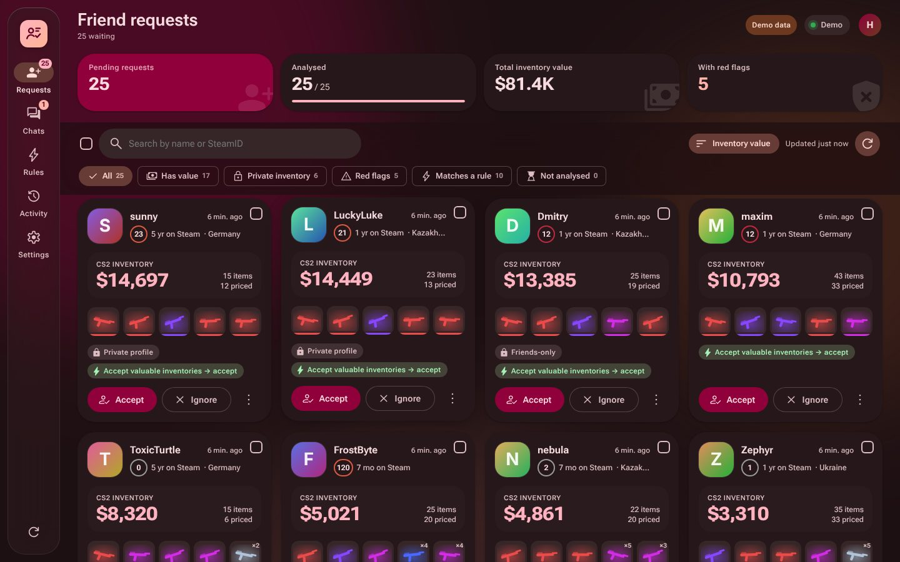

# steam-mfran

**Steam Multi Friend Requests Analyzer.** It cuts the time it takes to work through incoming Steam friend requests. MFRAN logs into your Steam account and keeps the session alive. It looks up every person who sent you a request, prices their CS2 inventory, and lets you accept, ignore, block or message many people at once. Rules can do this for you automatically.

It runs locally: a Python backend (FastAPI + aiohttp) talks to Steam, and a browser UI talks to the backend. The UI takes its look from Material 3 Expressive and Apple's glass materials.



| Request details & inventory | Steam chat |
| --- | --- |
|  |  |
| **Automation rules** | **Dark theme + custom accent** |
|  |  |

## Features

- **Persistent login.** You type your password and a Steam Guard code once. You can also approve the sign-in in the Steam Mobile app, or use an e-mail code. After that, MFRAN restores the session from the saved refresh token on every start and renews the web session before it expires. If Steam ever rejects the token, the UI asks for your password and code again.
- **Incoming friend requests.** MFRAN reads them from your pending-invites page and also receives them live through the Steam chat connection, so new invites appear without a refresh.
- **Per-request analysis.** For each request it collects:
  - Steam level, name and avatar
  - Account age, country, and VAC / trade-ban / limited-account status
  - Whether the profile is private
  - The full **CS2 inventory**: item count, the most valuable items, and an **estimated total value** in your currency
- **Triage UI.** Search, filter (has value, private inventory, red flags, rule matches…), sort (value, level, account age…), and **multi-select** with a floating toolbar for bulk **Accept / Ignore / Block / Accept & message**.
- **Automation rules.** Example: *"Ignore level-0 accounts with private inventories"* or *"Accept anyone with ≥ $500 and no VAC ban, then send them a message"*. You can preview matches, run rules on demand, or apply them automatically as each request is analysed.
- **Steam chat** in the browser:
  - Conversations with unread counts, typing indicators and presence
  - Each chat partner's **Steam level and CS2 inventory value** in the list, looked up in the background when friend-request analysis is idle
  - **Remove chat** hides a conversation until the next message arrives; it then comes back with its full history
  - **Remove friend** from the chat menu, optionally removing the chat at the same time
  - Full history with infinite scroll
  - Steam BBCode rendering (images, emoticons, stickers, spoilers, quotes, links)
  - **Image attachments**: picker, paste, or drag & drop
  - Desktop notifications
- **Broadcast.** Send the exact same message to many friends with per-recipient progress and spam-safe pacing. Message templates are saved in your browser.
- **Activity log** of every accept, ignore and block, whether you did it or a rule did.
- **Demo mode** with generated data, so you can try the whole UI without a Steam account.

## Quick start

Requires **Python 3.10+**. No Node.js needed: the UI is plain JavaScript modules served by the backend.

```bash
git clone https://github.com/HouwyTwitch/steam-mfran
cd steam-mfran
python -m venv .venv && source .venv/bin/activate   # Windows: .venv\Scripts\activate
pip install -r requirements.txt

python -m steam_mfran          # opens http://127.0.0.1:8777
python -m steam_mfran --demo   # try it with fake data first
```

You can also install it as a command with `pip install .`, then run `steam-mfran`.

### Options

| Flag | Env var | Default | |
| --- | --- | --- | --- |
| `--port` | `MFRAN_PORT` | `8777` | Web UI port |
| `--host` | `MFRAN_HOST` | `127.0.0.1` | Interface to listen on |
| `--data-dir` | `MFRAN_DATA` | `./data` | Session, settings and caches |
| `--proxy` | `MFRAN_PROXY` | – | HTTP(S) proxy for all Steam traffic (`HTTPS_PROXY` is honoured too) |
| `--token` | `MFRAN_TOKEN` | – | Require an access token (open `/?token=…` once) |
| `--allow-host` | – | – | Extra `Host` header to accept, e.g. a LAN hostname |
| `--demo` | – | off | Generated data, no Steam account |
| `--no-browser` | – | off | Don't open a browser tab |

Everything else is configured from **Settings** in the UI and saved to `data/settings.json`: price source, display currency, theme and accent colour, polling and rate-limit intervals, and broadcast pacing.

## How it works

### Login and session persistence

MFRAN uses the same `IAuthenticationService` flow as steamcommunity.com. The approach comes from [csfloat-auto-sale-and-trade](https://github.com/HouwyTwitch/csfloat-auto-sale-and-trade) (aiosteampy) and [node-steam-session](https://github.com/DoctorMcKay/node-steam-session). Unlike those, MFRAN needs no `shared_secret`: you type the Steam Guard code yourself, once.

1. `GetPasswordRSAPublicKey`, then the password is RSA-encrypted and sent with `BeginAuthSessionViaCredentials` (platform *WebBrowser*).
2. `UpdateAuthSessionWithSteamGuardCode` (mobile or e-mail code), or wait while you approve the login in the Steam Mobile app.
3. `PollAuthSessionStatus` returns a **refresh token**. This is saved to `data/session.json` with `0600` permissions. The password is never stored.
4. `login.steampowered.com/jwt/finalizelogin` exchanges the refresh token for `steamLoginSecure` cookies on every Steam domain.

Step 4 is repeatable while the refresh token is valid (months), so on startup, and whenever the ~24 h web token gets close to expiry, MFRAN simply runs it again. The saved Steam Guard machine token is reused too, so an e-mail-guarded account isn't asked for a new code on every full re-login.

### Where the data comes from

| What | Endpoint |
| --- | --- |
| Pending invites | `steamcommunity.com/profiles/<you>/friends/pending` (HTML) and live `ClientFriendsList` updates over the CM connection |
| Accept / ignore / block | `POST …/friends/action` (bulk, same request the website makes), with `actions/AddFriendAjax` etc. as fallback |
| Level, name, avatar, badge | `steamcommunity.com/miniprofile/<accountid>/json/` |
| Account age, bans, privacy, country | `steamcommunity.com/profiles/<id>/?xml=1` |
| CS2 inventory | `steamcommunity.com/inventory/<id>/730/2` (paged, rate-limited, cached) |
| Prices | csgotrader.app Steam prices (default), Skinport, Market.CSGO, or the live Steam Market (`priceoverview`, slow) |
| Chat | Steam CM WebSocket, logged on as a *web* client with the token from `/chat/clientjstoken`, the same way steamcommunity.com/chat works: `FriendMessages.SendMessage/GetRecentMessages/GetActiveMessageSessions/AckMessage` and `FriendMessagesClient.IncomingMessage` notifications. If the CM link is down, MFRAN falls back to the `IFriendMessagesService` WebAPI and polls. |
| Remove friend | `POST actions/RemoveFriendAjax` (`sessionID`, `steamid`), as the profile page's "Remove Friend" button does |
| Chat images | `chat/beginfileupload` → PUT to Steam's CDN → `chat/commitfileupload` (Steam posts the image into the conversation) |

The protobuf messages are described in `steam_mfran/steam/proto.py` with a small built-in codec, so there is no generated code. Their field numbers are checked against the official definitions from [SteamDatabase/Protobufs](https://github.com/SteamDatabase/Protobufs).

### Inventory values are estimates

Prices come from public bulk price lists and are cached on disk. Items without a market price (medals, service coins, non-marketable items) are counted but not valued. Each card shows *N items · M priced* so you can tell. The goal is to rank requests, not to appraise items to the cent.

Steam rate-limits inventory requests hard. MFRAN spaces them out (Settings → *Pause between inventory requests*). When Steam answers HTTP 429 it backs off automatically, and the card shows when it will retry.

## Security notes

- **`data/session.json` is a login credential.** Anyone with it can use your Steam account until the token is revoked. Keep `data/` private; it is git-ignored. *Sign out* in Settings deletes it. To revoke every session remotely, use Steam → Account → *Authorized devices* → *Remove* / *Sign out everywhere*.
- The server listens on `127.0.0.1` only by default. It rejects requests with a foreign `Host` header (DNS rebinding) or a foreign `Origin` (CSRF). If you expose it on a network with `--host 0.0.0.0`, also set `--token`.
- **Network logs contain your session.** A Chrome `net-export` log captured while logged in to Steam includes your `steamLoginSecure` and refresh-token cookies. Don't share such logs publicly. If you already did, sign out of all devices in Steam.

## Development

```bash
pip install -r requirements-dev.txt
pytest                     # protocol, auth flow, chat (fake CM server), parsers, API
python -m steam_mfran --demo --port 8790
```

```
steam_mfran/
  steam/          Steam protocol: proto codec, auth, community pages, inventory, pricing, CM client, chat
  core/           session state machine, app service (analysis queue, rules, broadcasts), demo backend
  server.py       FastAPI REST + /api/events websocket + static UI
  web/            UI: Preact + htm + signals (vendored ESM, no build step), Material You colour utils
tests/            pytest suite with fake Steam HTTP + fake CM websocket
```

The UI is plain ES modules. Edit `steam_mfran/web/js/**` and reload the page. `web/vendor/` holds esbuild bundles of `preact`, `@preact/signals`, `htm` and `@material/material-color-utilities`. `web/js/icons-data.js` is a generated subset of Material Symbols Rounded.

## Disclaimer

Not affiliated with Valve. Automating actions on your Steam account is at your own risk. Keep the pacing settings reasonable so Steam doesn't treat you as a spammer.
